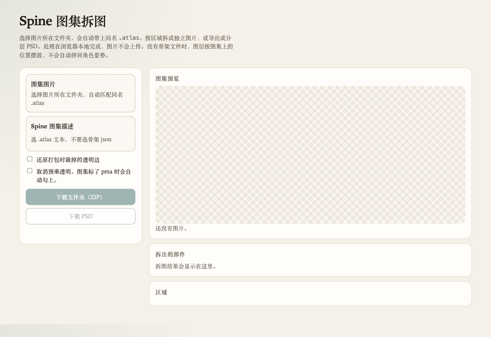
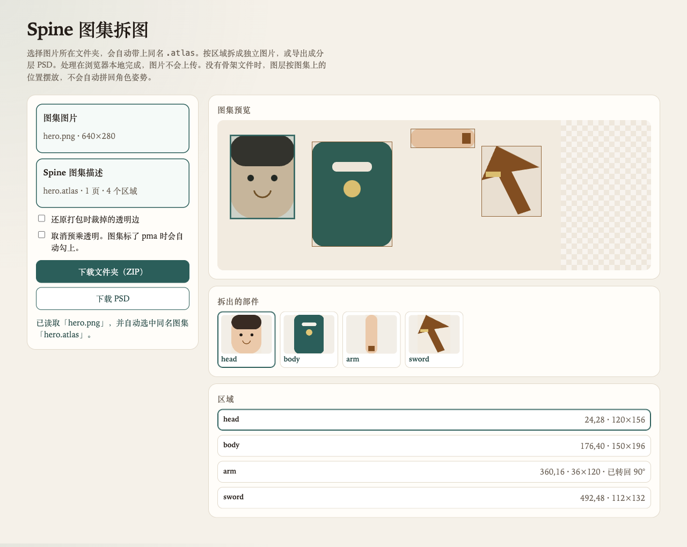

# Spine 图集拆图

在浏览器里按 Spine 的 `.atlas` 描述，把一张打好包的图集 PNG 拆成独立图片，或导出成分层 PSD。文件只在本地处理，不会上传。

## 打开

这是纯静态页面。把 `index.html`、`app.js`、`ui.js` 放在同一目录，双击 `index.html` 即可。不需要服务器。

## 使用

1. 选择图片所在文件夹。若其中有同名文件，例如 `hero.png` 和 `hero.atlas`，会自动一起载入。
2. 也可以单独选择 `.atlas` 文本。不要选骨架 `.json`。
3. 右侧会列出区域。两边都选好之后，预览里画出每个区域，并给出拆开的缩略图。
4. 导出：
   - **下载文件夹（ZIP）**：每个部件一张 PNG
   - **下载 PSD**：每个部件一层，按它在图集上的位置摆放

可选：

- **还原打包时裁掉的透明边**：按 atlas 里的 `offsets` / `orig` 把部件放回裁切前的画布。
- **取消预乘透明**：图集标了 `pma: true` 时会自动勾上。

## 示例

打开页面后，点「图集图片」，选择图片所在的文件夹。

文件夹里有同名文件时会一起载入，例如 `hero.png` 和 `hero.atlas`。预览框出每个区域。`arm` 在图集上是横放的，拆出来后转回竖直。

## 坐标和限制

区域的 `xy` / `bounds` 从图片左上角算起。`rotate: true` 或 `90` 表示这块图在图集里逆时针转了 90°，导出时会转回去。也支持 180° 和 270°。

只有图集描述时，图层不会按骨架的 setup pose 拼回角色。那份位置在 `.json` 或 `.skel` 里，这个页面不读骨架。

## 文件

| 文件 | 作用 |
|------|------|
| `index.html` | 页面 |
| `app.js` | 解析 atlas、拆图、生成 PSD 和 ZIP |
| `ui.js` | 选择文件和预览 |
